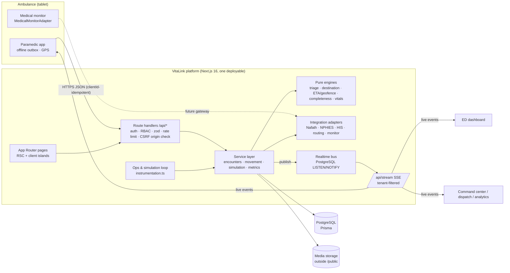
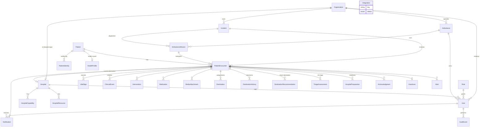
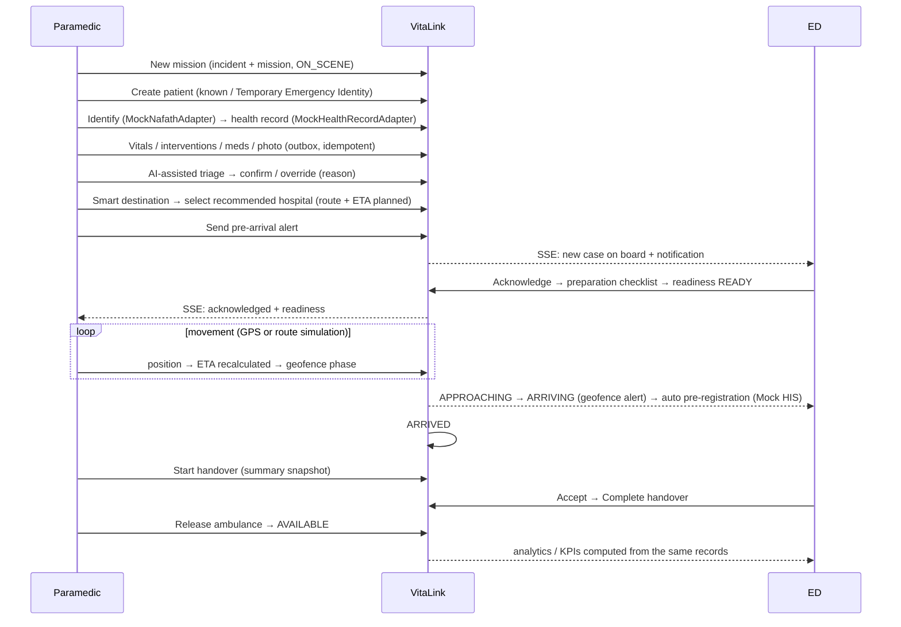

# VitaLink: architecture

## 1. System architecture

**Key decisions**

| Concern | Choice | Why |
|---|---|---|
| App shape | Single Next.js 16 project (App Router), `src/lib/services` as the domain layer | One deployable; server components read the DB directly through tenant-scoped queries, mutations go through audited API routes |
| Data | PostgreSQL + Prisma 6 | Relational clinical journey, strong constraints, `LISTEN/NOTIFY` for realtime |
| Auth | Auth.js v5 (credentials) + bcrypt, JWT session (10 h) | Every request re-validates the user in the DB (`getCurrentUser`) so a deactivated user loses access immediately |
| Realtime | Server-Sent Events fed by Postgres `LISTEN/NOTIFY` | Works across processes; events are small invalidation signals, and clients re-render server data with `router.refresh()`, so there is no duplicated client state |
| Offline | Client outbox in `localStorage` (AES-GCM, per-user key held only in tab memory), ordered delivery, exponential backoff, server de-duplication by `clientId` | The paramedic never sees "sent" until the server confirms (`PENDING → RETRYING → FAILED / DELIVERED`) |
| AI | Transparent rule engine (`engines/triage.ts`, `engines/destination.ts`) | Explainable and testable; no external AI API; labelled as demo decision support |
| Integrations | Adapter interfaces + mock implementations + status registry | Honest status (`SIMULATED / NOT_CONFIGURED / …`); live adapters refuse to run without credentials |
| Caching | `cacheComponents: false` | Every page is authenticated and live; nothing is pre-rendered per user |

## 2. ERD

All 28 requested entities exist in `prisma/schema.prisma`, plus `HealthProfile`.

## 3. Page structure

| Route | Purpose | Roles |
|---|---|---|
| `/` | Landing | public |
| `/login` | Sign in (+ demo accounts when `DEMO_MODE`) | public |
| `/app` | Redirects to the role's home | all |
| `/paramedic` | Ambulance home: new mission, dispatched mission, recent missions | PARAMEDIC |
| `/paramedic/[encounterId]` | Tablet workspace: patient, quick actions, vitals, triage, destination, ETA, map, handover, release, outbox | PARAMEDIC |
| `/ed` | ED board: incoming, critical, ETA, unacknowledged, resources, alerts, map, diverted-away | ED_* , HOSPITAL_COORDINATOR, SUPER_ADMIN |
| `/ed/resources` | Resource availability + capabilities | ED_ADMIN, HOSPITAL_COORDINATOR, SUPER_ADMIN |
| `/cases`, `/cases/[id]` | Case list (masked IDs) / case view with 12 tabs | all with `case:read` (tenant-scoped) |
| `/dispatch` | Incident creation & dispatch, active missions, divert, pending recommendations, fleet, map | EMS_DISPATCH, EMS_ADMIN, SUPER_ADMIN |
| `/command` | Operations command center (KPIs, live map, hospital loads, exceptions) | `command:read` |
| `/mci` | Mass casualty overview | `command:read` |
| `/incidents`, `/incidents/[id]` | Incident module (multi-ambulance / multi-patient) | EMS + platform |
| `/alerts`, `/notifications` | Alert engine output / in-app notifications | all |
| `/analytics/[view]` | 10 analytics views | OPERATIONS_ANALYST, ED_ADMIN, EMS_ADMIN, SUPER_ADMIN |
| `/reports` | Weekly performance report + CSV + print | `reports:read` |
| `/admin/audit` | Audit log | AUDITOR, ED_ADMIN, EMS_ADMIN, SUPER_ADMIN |
| `/admin/integrations` | Integration status (mode switch for SUPER_ADMIN) | `integrations:read` |
| `/admin/users` | Users & roles | `users:read` |
| `/demo` | Demo simulation panel | SUPER_ADMIN, EMS_ADMIN, EMS_DISPATCH |

## 4. Roles & permissions

Defined in `src/lib/rbac.ts` (also stored in the `Role` table). Highlights:

- **PARAMEDIC**: create missions and encounters, all clinical documentation, identify patient, run and decide triage, request a recommendation, select the *initial* destination, start the handover, release the ambulance. Scope: their ambulance only.
- **EMS_DISPATCH / EMS_ADMIN**: dispatch, **change destination / approve recommendations**, command center, demo. Scope: their EMS operator.
- **ED_NURSE / ED_DOCTOR**: acknowledge, prepare, receive the handover, read the health record. Scope: cases destined to their hospital (+ cases diverted away, read-only).
- **ED_ADMIN / HOSPITAL_COORDINATOR**: plus resources (and capabilities for ED_ADMIN), analytics/reports for ED_ADMIN.
- **OPERATIONS_ANALYST**: analytics, reports, command center (read-only).
- **AUDITOR**: audit log, reports, read-only cases.
- **SUPER_ADMIN**: everything, including the integration mode switch.

## 5. Main workflow

Encounter status machine: `CREATED → ACTIVE → PRE_ALERT_SENT → ACKNOWLEDGED → PREPARING → APPROACHING → ARRIVED → HANDOVER → COMPLETED`, with `DIVERTED` (after a destination change, until the new ED acknowledges) and `CANCELLED`.

## 6. API design

All endpoints are JSON, require a session, check permissions and tenant scope, validate with zod (`src/lib/validation/schemas.ts`), are rate-limited per user, reject cross-origin mutations, and write audit events.

| Method & path | Permission | Action |
|---|---|---|
| `POST /api/missions` | case:create / dispatch:manage | Create incident + mission (paramedic self-start or dispatch) |
| `POST /api/missions/:id/on-scene` | case:create | Mark on scene |
| `POST /api/missions/:id/drive` | case:create / demo:run | `start · stop · step · geofence · arrive` (route simulation) |
| `POST /api/missions/:id/release` | ambulance:release | Return to service |
| `POST /api/ambulances/:id/position` | case:create | Device GPS → ETA + geofence |
| `POST /api/encounters` | case:create | Create encounter (unknown patient supported) |
| `POST /api/encounters/:id/identify` | identity:verify | Digital identity + health record |
| `POST /api/encounters/:id/vitals` | case:clinical_write | Batch vitals (`clientId` idempotent) |
| `POST /api/encounters/:id/{interventions,medications,notes,condition,priority,cancel}` | case:clinical_write | Clinical documentation |
| `POST /api/encounters/:id/media` | media:upload | Multipart upload (type + magic-byte check, size limits) |
| `GET  /api/media/:id` | media:read | Protected, audited media delivery |
| `POST /api/encounters/:id/monitor` | case:clinical_write / demo:run | Mock monitor stream start/stop |
| `POST /api/encounters/:id/triage` · `POST /api/triage/:id/decision` | triage:run / triage:decide | AI-assisted triage, confirm or override |
| `POST /api/encounters/:id/recommend` | destination:recommend | Smart destination ranking |
| `POST /api/encounters/:id/destination` | destination:select_initial | Initial destination (before pre-alert) |
| `POST /api/encounters/:id/divert` | destination:change | Destination change with reason |
| `POST /api/recommendations/:id/decision` | recommendation:approve | Dispatch approval |
| `POST /api/encounters/:id/prealert` | case:clinical_write | Pre-arrival alert (delivery tracked) |
| `POST /api/encounters/:id/{acknowledge,preparation,readiness}` | case:acknowledge / case:prepare | Hospital readiness |
| `POST /api/encounters/:id/handover` | handover:start / handover:receive | `start · accept · complete` |
| `POST /api/hospitals/:id/{resources,capabilities}` | hospital:resources / hospital:capabilities | Resource management |
| `POST /api/alerts/:id` | alerts:manage | Acknowledge / resolve |
| `GET/POST /api/notifications` | any | List / mark read |
| `POST /api/integrations/:key` | integrations:manage | Mode switch (live modes require credentials) |
| `GET /api/reports/weekly?week=&format=csv` | reports:read | Weekly report JSON / CSV |
| `POST /api/demo` | demo:run | Demo simulation actions |
| `GET /api/stream` | any | SSE live events (tenant-filtered) |
